# Plushies Elevator

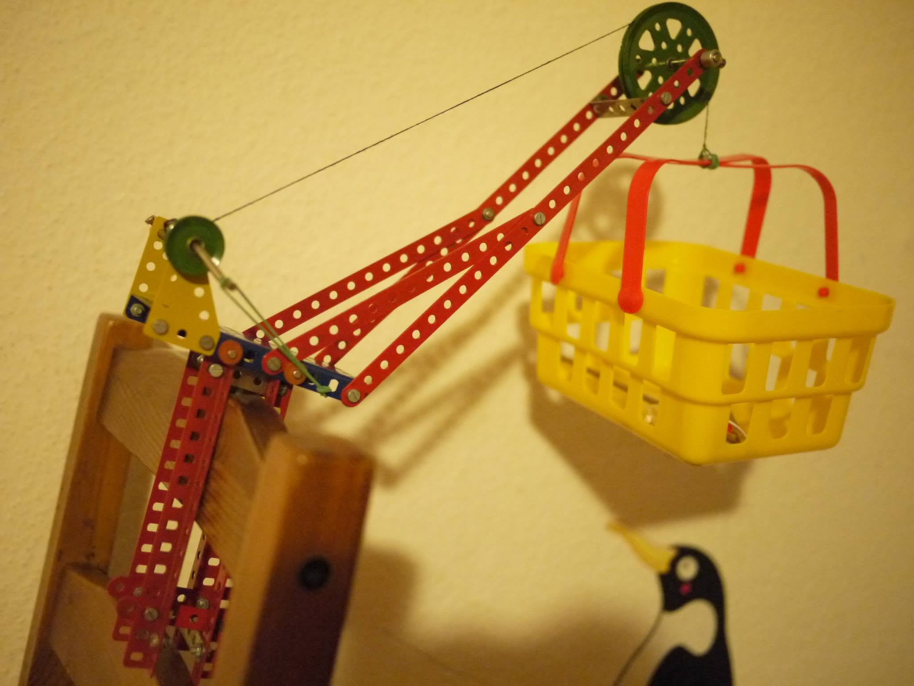

## 2014-04-21

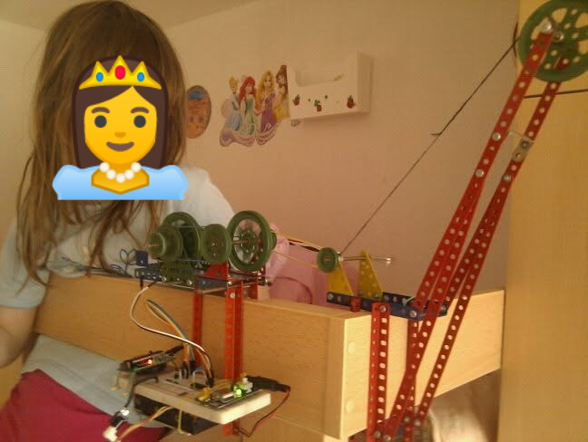

Controlling the motor with an ATmega328 (Arduino) MCU: potentiometer in, PWM out. Two power supplies to allow for a more powerful motor.

## 2014-04-25

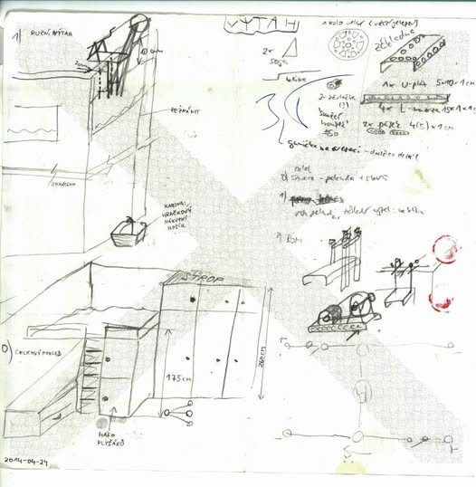 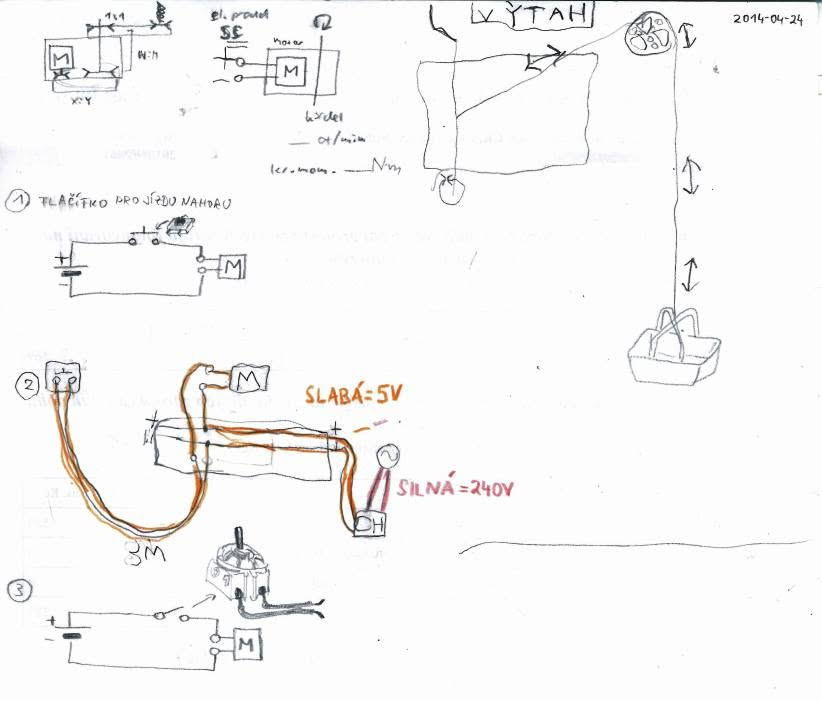 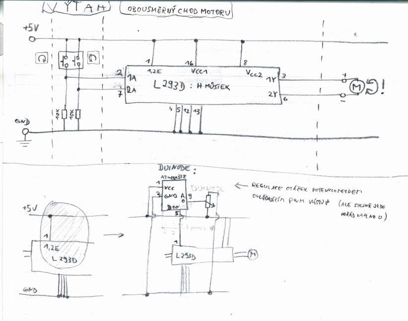

## 2014-04-26

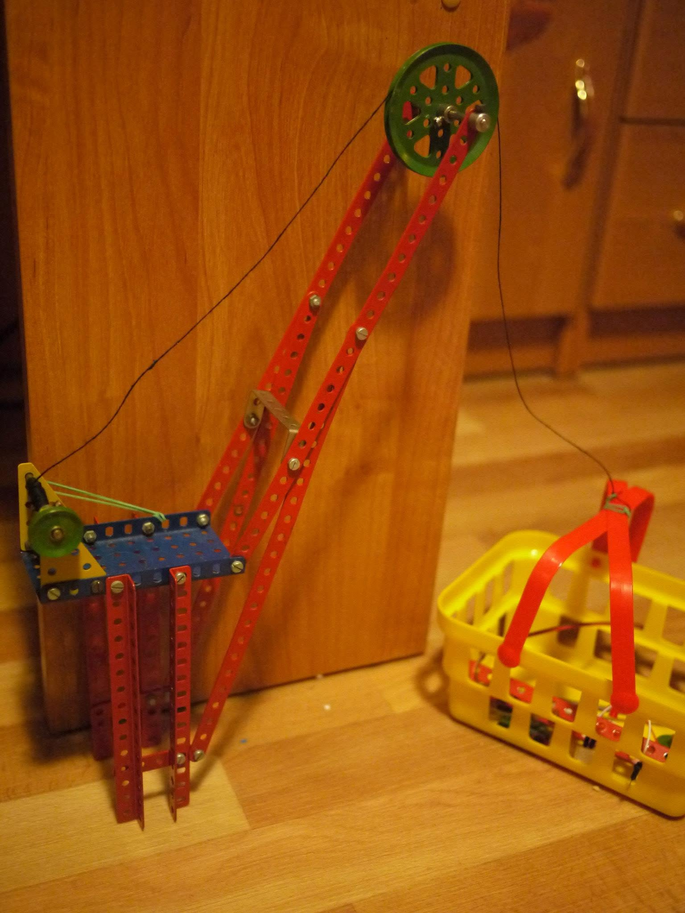

Výtahový jeřáb, verze 1

Elevator crane, version 1

Výtahový jeřáb, v2: složený. Klička přístupná pro praváky.

Elevator crane, v2: mounted. Crank accessible for right-handed people.

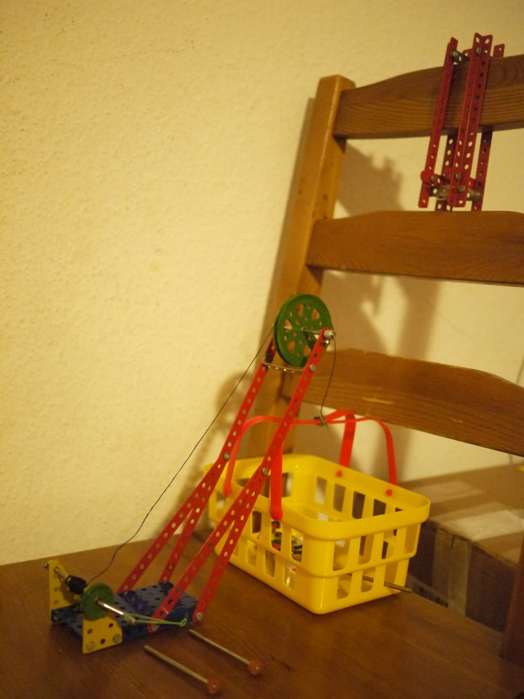

Výtahový jeřáb, v2: rozložený. Nyní se dá výtah snadno sundat a vylepšovat, aniž bych musel lézt na palandu nebo budit spící dětičky.

Elevator crane, v2: unmounted. Now the elevator can be easily taken down and improved without me having to climb the bunk bed or risk waking the sleeping kids.

## 2014-04-29

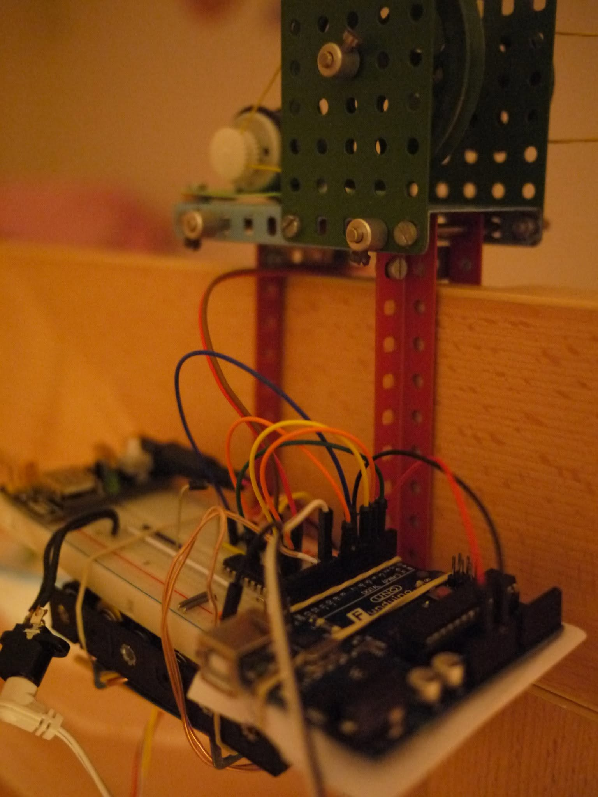

Wired up! Click (not hold) buttons to move the elevator; station sensors to stop moving; use less power for descending.

It has worked well on the kitchen table, but I cannot try the real thing while the kids are sleeping... (actually... I could IF my wife had headphones on!)

## 2014-04-30

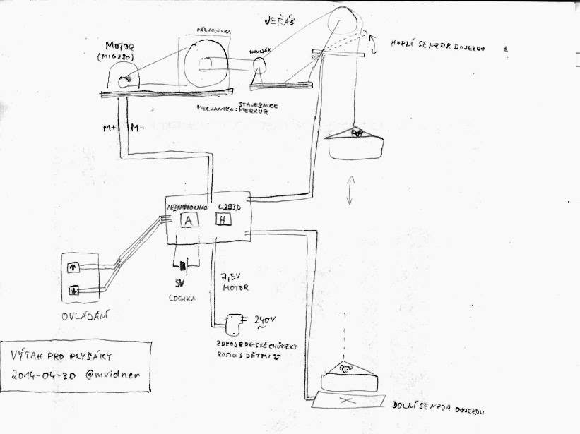

Včerejší zapojení / Last night's wiring

## 2015-10-05

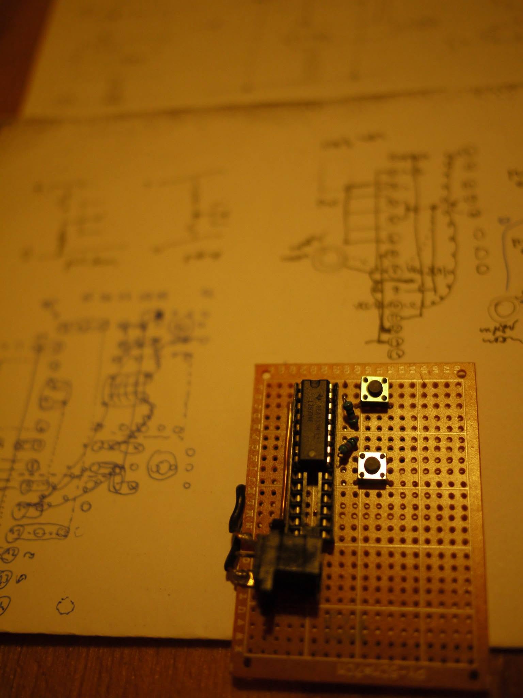 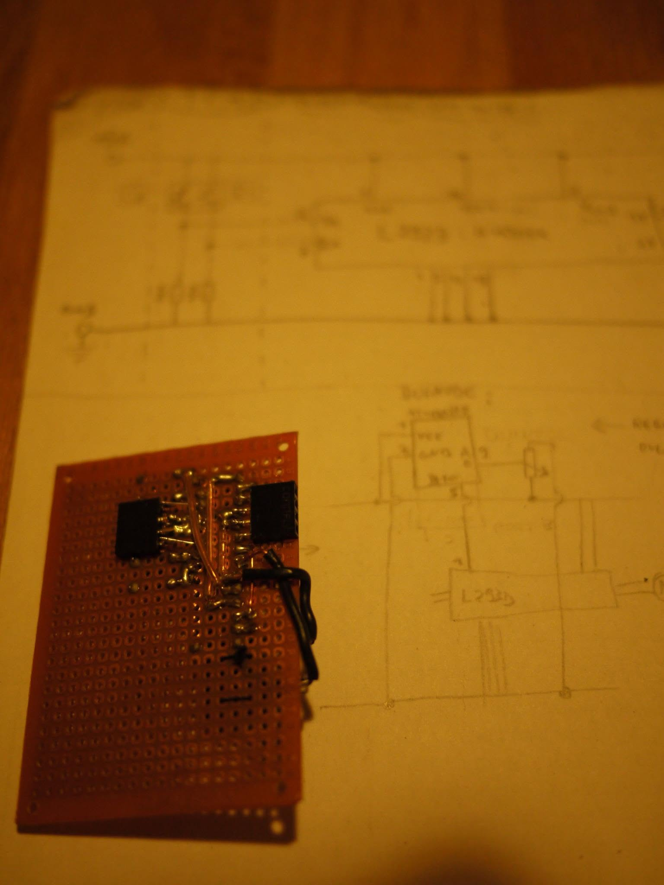

Another step to a more durable Elevator for Plush Friends:

An L293D H-bridge in a module to drive a 7.5 V DC motor in both directions, either manually by pushbuttons or programatically by 2 directional and 1 PWM pin.

Now I know why the prototype board has labels on rows and columns. And I really should get a solder sucker.

After adding two more bugfix wires, manual control is confirmed to work.

## 2015-11-07

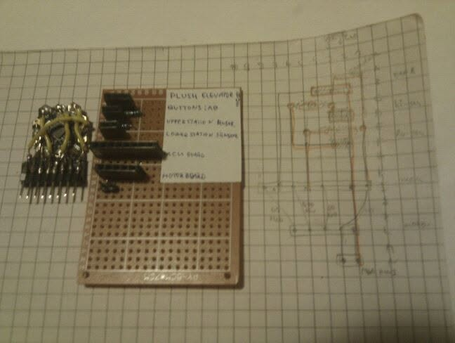

Modularity obsession: the bus board, with connectors for the up-down-stop button board, stop-you-are-too-high/low buttons, the processor board, and the motor control board.

Pro tip: if you realize that some crossed wires would short-circuit when pressed too hard, just stick a bit of insulation between them.

## 2015-11-11

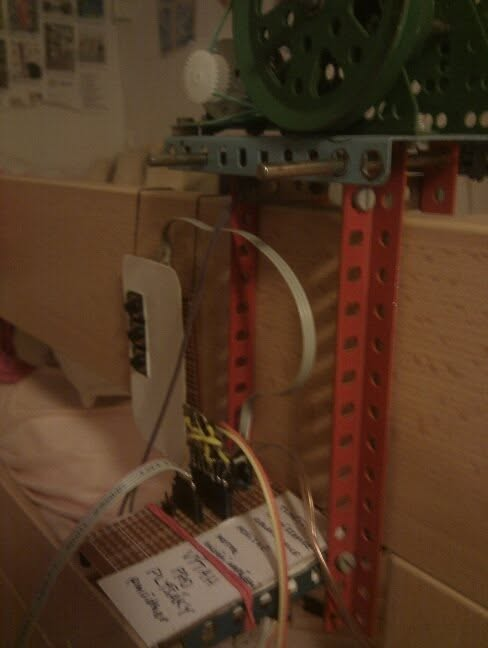

TA-DÁÁÁ!

Konečně jezdí jako loni, v trvanlivé modulární sestavě.

Finally it's working like last year, in a durable modular assembly.

Jo, je to bastl, protože tam je vidět spousta drátů a vnitřnosti nejsou schované za plastovou skořápkou.

Ovšem na rozdíl od loňska už to není jen tak zastrkané v breadboardu s Arduinem Uno: je v tom Cheapduino, Atmega 😎, má to samostatné moduly pro tlačítka, pro řízení motoru, které půjdou použít v dalších verzích na dálkové ovládání. Mimo obraz jsou funkční dojezdová tlačítka, takže řidička se nemusí strachovat, že jí plyšouna v horní stanici sežere stroj. Vylepšení mechanické stránky vynále^H^H^H hračky je ve frontě až za sepsáním návodu na elektronickou stránku. A pak hurá na Kickstarter 🙂

Yes, it's a hack, because a lot of wires is visible and the guts are not hidden by a plastic shell.

But, compared to last year, it is not just plugged into a breadboard with an Arduino Uno: it has a Cheapduino, Atmega 😎, it has separate modules for the buttons and motor control, these will be reusable for future versions with remote control. Outside the photo there are working endstops so that the operator does not have to worry about her plushie being eaten by the machine in the upper station. Improving the mechanical aspect of the inventi^H^H^H toy is in the queue after writing up the instructions for the electronic aspect. And then off to Kickstarter 🙂

# Other hardware toys

## 2017-04-17

[2017-04-17-blink.mp4](videos/2017-04-17-blink.mp4)

https://github.com/user-attachments/assets/346d8633-16e7-441c-b54e-f796d9f77266

Easter, a celebration of new life!

This new blinkenlight of mine is controlled by an ATtiny13A (RAM: 64 bytes, Program: 1024 bytes, Price: 1 EUR).

The program size is 30 bytes. I dare say I am outgrowing my Arduino script kiddie roots.

## 2017-04-30

[2017-04-30-transistor.mp4](videos/2017-04-30-transistor.mp4)

https://github.com/user-attachments/assets/fde7afcd-d87b-4f59-9af8-81f8f72089e3

Vy se mi budete smát, ale já jsem na sebe děsně pyšnej: Použil jsem tranzistor! Fakt to zesiluje proud a nemusíte mít přilepený ucho na repráčku. A to jste věděli, že když to máte zapojit E-B-C a místo toho dáte C-B-E, tak to nezesiluje?

You will laugh at me but I am immensely proud of myself: I have used a transistor! It really amplifies the current so that you don't have to hug the speaker with your ear. And did you know that if you connect the pins like C-B-E instead of E-B-C, no amplification takes place?

Followed the steps at https://makezine.com/projects/advanced-arduino-sound-synthesis/

## 2017-05-20

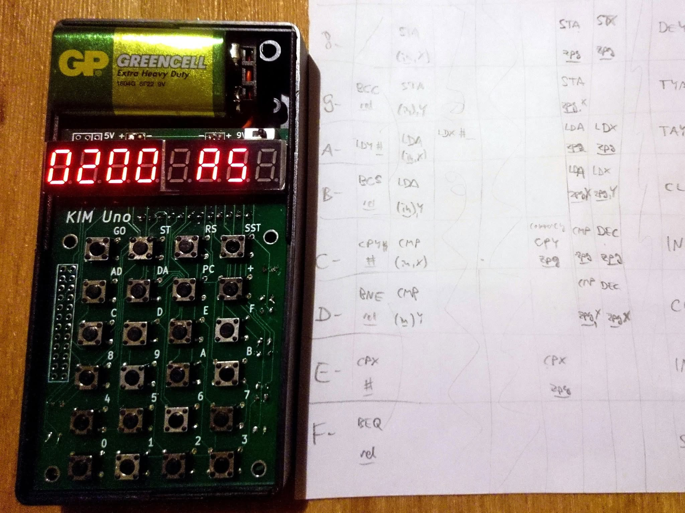

Can you program a computer in machine code? I once could (a Z80) so I jumped at this opportunity to do it again: KIM Uno, an Arduino powered replica of the first 6502-based computer.

https://obsolescence.wixsite.com/obsolescence/kim-uno-summary-c1uuh

## 2018-03-11

[2018-03-11-cajik.mp4](videos/2018-03-11-cajik.mp4)

https://github.com/user-attachments/assets/bb1258c3-edf2-4142-8d6c-7566ee41196f

The improved robot can lift a little over 100g and is gentle enough to carry a cup of tea.

Vylepšený robot uzvedne něco přes 100g a je dost šetrný aby uvezl šálek čaje.
